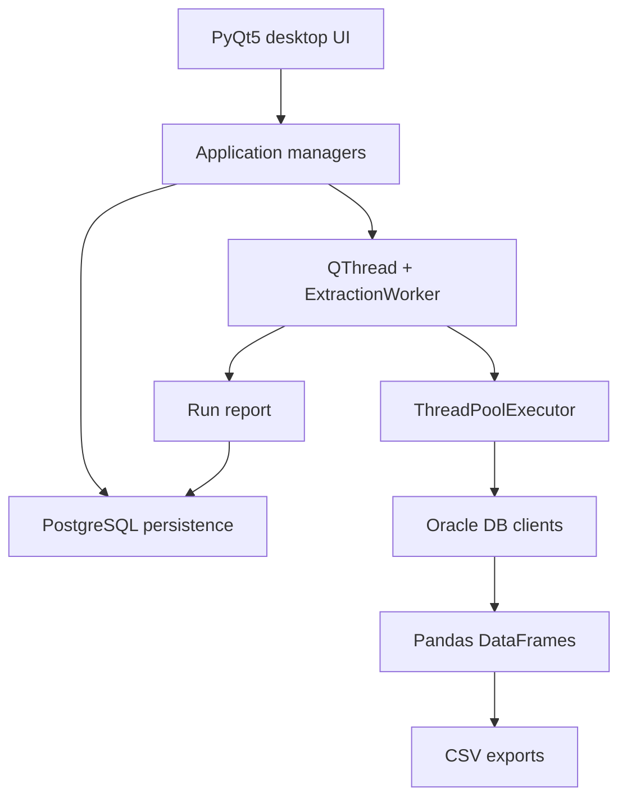

# Data Extraction Tool

<p align="center">
  
  
  
  
  
</p>

A Python desktop application for managing data extraction requests and exporting data from configured Oracle environments. It combines a PyQt5 interface, PostgreSQL-backed application configuration, and concurrent query execution to generate structured CSV exports.

## Features

- Manage Oracle connection definitions and SQL extraction queries.
- Organize queries into reusable presets and export configurations.
- Manage service requests and associate them with export configurations.
- Execute extraction tasks in background threads with bounded concurrency.
- Export query results as UTF-8 CSV files.
- Maintain a history of successful extraction runs.

## Architecture



See [Architecture](docs/architecture.md) for the component breakdown and extraction lifecycle.

## Technology stack

| Area | Technologies |
|---|---|
| Desktop UI | Python, PyQt5 |
| Application data models | Pydantic |
| Application persistence | PostgreSQL, psycopg2 |
| Source data access | Oracle, python-oracledb |
| Data processing and export | Pandas |
| Configuration | python-dotenv |
| Packaging | PyInstaller specification included |

## Getting started

### Prerequisites

- Python installed.
- Access to the required PostgreSQL database.
- Access to the Oracle source environments.
- The required PostgreSQL `extraction` schema, tables, and views provisioned.

### Install

```bash
git clone https://github.com/saadahmed388/data-extraction-tool.git
cd data-extraction-tool

python -m venv .venv
```

Activate the virtual environment, then install dependencies:

```bash
pip install -r requirements.txt
```

Create a `.env` file in the project root:

```dotenv
DATABASE_URL=postgresql://<username>:<password>@<host>:<port>/<database>
```

Start the application:

```bash
python app.py
```

For complete instructions, see [Setup and Deployment](docs/setup-and-deployment.md).

## Project structure

```text
.
├── app.py
├── config/
├── core/
│   ├── executors/
│   ├── exceptions/
│   ├── managers/
│   ├── models/
│   ├── oracle/
│   └── postgres_managers/
├── ui/
├── utils/
├── assets/
├── data_and_config_files/
├── logs/
├── docs/
└── requirements.txt
```

## Export format

```text
exports/
└── export_mftbcffr_<SR_NUMBER>_<DDMMYYYY>/
    └── <QUERY_CLASS>/
        └── <ENVIRONMENT_NAME>.csv
```

## Documentation

- [Architecture](docs/architecture.md)
- [Database Design](docs/database-design.md)
- [Setup and Deployment](docs/setup-and-deployment.md)

## Notes

The repository does not currently include the complete PostgreSQL schema DDL or migration scripts. Provision the required database objects separately before running the application. Review the database documentation for credential-handling considerations.

## License

See [LICENSE](LICENSE).
