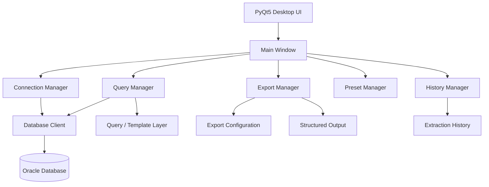

# Data Extraction Tool

> A desktop database extraction application for retrieving environment-specific operational data through reusable SQL queries and exporting the results into structured outputs.

[](https://www.python.org/)
[](https://www.qt.io/qt-for-python)
[](https://www.oracle.com/database/)
[](LICENSE)

## Overview

The **Data Extraction Tool** is a Python-based desktop application for extracting environment-specific data from Oracle databases using reusable, predefined SQL queries and exporting the results in structured formats.

It is designed around a repeatable extraction workflow:

```text
Configure Environment
       ↓
Select / Define Query
       ↓
Execute Extraction
       ↓
Inspect Results
       ↓
Apply Export Configuration
       ↓
Generate Structured Output
       ↓
Persist Extraction History
```

The application uses **PyQt5** for the desktop interface and `oracledb` for Oracle connectivity, with dedicated components for connections, queries, presets, export configuration, extraction history, staging, and output management.

## Key Features

### 🗄️ Environment-Aware Database Extraction
- Connect to configured database environments.
- Keep database access isolated in the core database layer.
- Execute reusable SQL queries against the selected environment.
- Support environment-specific extraction workflows.

### 🔍 Query Management
- Create and maintain reusable SQL queries.
- Store query metadata such as creation/modification timestamps.
- Delete obsolete queries.
- Load query definitions from persistent JSON storage.

### 📤 Configurable Export
- Define reusable export configurations.
- Create named extraction/export definitions.
- Track when an extraction was performed.
- Store extraction-related logging information.
- Separate extraction configuration from the extraction engine.

### 📚 Presets & History
- Maintain reusable presets.
- Keep extraction history for operational traceability.
- Store configuration locally in JSON-based application data.

### 🖥️ Desktop UI
The application includes dedicated views for:
- Database connections
- Queries
- Results
- Export configuration
- Export execution
- Presets
- Extraction history

## Architecture



## Component Responsibilities

| Component | Responsibility |
|---|---|
| `ui/` | Desktop screens and user interaction |
| `core/db_client.py` | Database communication |
| `core/db_config_manager.py` | Database/environment configuration |
| `core/query_manager.py` | Query persistence and lifecycle |
| `core/export_manager.py` | Export definitions and metadata |
| `core/export_configuration_manager.py` | Export configuration management |
| `core/preset_manager.py` | Reusable extraction presets |
| `core/history_manager.py` | Extraction history |
| `core/query_class_manager.py` | Query classification/organization |
| `core/staging.py` | Intermediate extraction/staging logic |
| `core/template_engine.py` | Template processing |
| `config/` | Application configuration |
| `data_and_config_files/` | Local persistent application data |
| `utilities/` | Supporting utilities and logging |
| `assets/` | Application resources |

## Project Structure

```text
data-extraction-tool/
│
├── app.py
├── requirements.txt
│
├── core/
│   ├── db_client.py
│   ├── db_client_old.py
│   ├── db_config_manager.py
│   ├── export_configuration_manager.py
│   ├── export_manager.py
│   ├── history_manager.py
│   ├── preset_manager.py
│   ├── query_class_manager.py
│   ├── query_manager.py
│   ├── staging.py
│   ├── template_engine.py
│   └── managers/
│       ├── connection_manager.py
│       ├── export_configuration_manager.py
│       ├── export_manager.py
│       ├── history_manager.py
│       ├── preset_manager.py
│       ├── query_class_manager.py
│       └── query_manager.py
│
├── ui/
│   ├── main_window.py
│   ├── connections_view.py
│   ├── export_configs_view.py
│   ├── export_view.py
│   ├── history_view.py
│   ├── presets_view.py
│   ├── queries_view.py
│   └── results_view.py
│
├── config/
├── data_and_config_files/
├── utilities/
├── assets/
├── logs/
├── build/
└── dist/
```

## Technology Stack

| Technology | Purpose |
|---|---|
| Python | Application logic |
| PyQt5 | Desktop GUI |
| `oracledb` | Oracle database connectivity |
| Pandas | Data manipulation and tabular processing |
| `regex` | Pattern matching and parsing |
| JSON | Local configuration and state |
| PyInstaller | Desktop packaging |

The authoritative dependency list is maintained in `requirements.txt`.

## Installation

### Prerequisites

- Python 3.x
- Oracle database access
- Valid credentials for the required environment(s)
- Windows if using the packaged desktop distribution

### Clone

```bash
git clone https://github.com/saadahmed388/data-extraction-tool.git
cd data-extraction-tool
```

### Create a virtual environment

```bash
python -m venv .venv
```

Windows:

```bash
.venv\Scripts\activate
```

### Install dependencies

```bash
pip install -r requirements.txt
```

## Run

```bash
python app.py
```

On startup, the application initializes logging, creates the PyQt5 application instance, loads the main window, and enters the GUI event loop.

## Typical Usage

### 1. Configure a database environment

Provide the connection information required by the application's database configuration layer.

### 2. Create or select a query

Queries are stored as reusable definitions rather than requiring the operator to repeatedly enter SQL.

### 3. Execute the extraction

Run the selected query against the intended environment.

### 4. Review the results

Inspect the extracted records in the results view before producing the final output.

### 5. Apply export configuration

Select the required export configuration/preset and generate the desired structured output.

### 6. Review extraction history

Use the history view to understand previous extraction activity.

## Data & Configuration

The application uses JSON-backed local state for several operational entities, including queries and export definitions.

For example, the export manager persists named exports with metadata such as:

```json
{
  "config_name": "",
  "extracted_on": "No Extractions Yet",
  "extraction_log": ""
}
```

This makes configurations reusable while keeping the extraction engine separate from the presentation layer.

## Design Principles

### Reusability

Queries and export configurations are persisted so common extraction jobs do not have to be rebuilt from scratch.

### Separation of Concerns

Database connectivity, query management, export configuration, history, and UI presentation are separated into dedicated components.

### Environment Awareness

The database layer is designed around configured environments, reducing the risk of treating different database targets as interchangeable.

### Traceability

Extraction definitions and history provide a record of operational extraction activity.

## Security Considerations

The application can connect to enterprise databases. Before using it with sensitive environments:

- Never commit credentials to Git.
- Use least-privilege database accounts.
- Restrict access to configuration files containing connection information.
- Validate the selected environment before extraction.
- Avoid exporting sensitive data to uncontrolled locations.
- Review generated exports before sharing them.

## Packaging

The repository contains PyInstaller/build artifacts and an application specification. Packaging should follow the existing project spec/build configuration.

## Logging

Application startup and unhandled exceptions are logged through the configured logging utility. This provides an operational trail for troubleshooting failed extraction runs.

## License

This project is licensed under the **Apache License 2.0**. See [LICENSE](LICENSE).

## Author

**Saad Ahmed**

GitHub: https://github.com/saadahmed388
