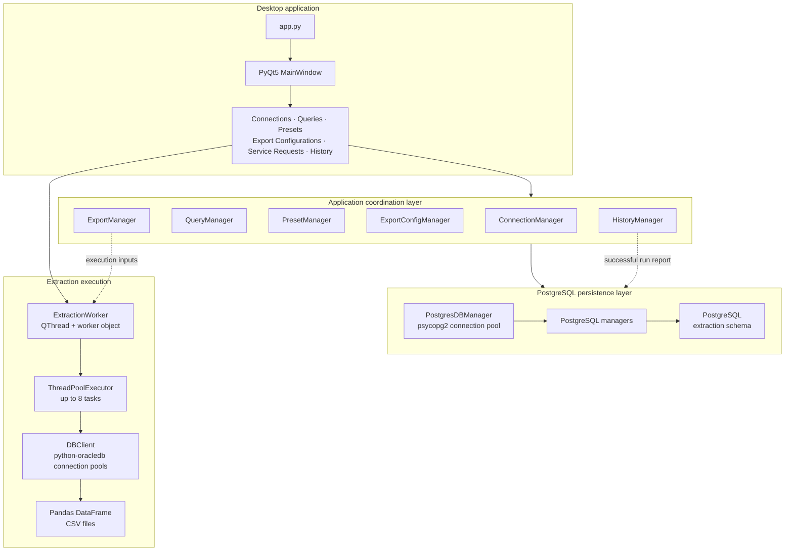
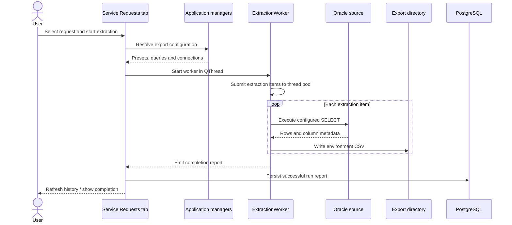

# Architecture

## 1. Purpose

The Data Extraction Tool is a desktop application for managing extraction requests and exporting data from configured Oracle environments. The application uses PyQt5 for its user interface, PostgreSQL for application metadata and configuration persistence, and `python-oracledb` for querying source databases.

This document describes the architecture visible in the current repository. It is not a deployment topology or a complete infrastructure specification.

## 2. High-level architecture



## 3. Architectural layers

### User interface

The `ui/` package contains the PyQt5 main window and the six application tabs:

- Connections
- Extraction Queries
- Presets
- Export Configurations
- Service Requests
- History

`app.py` initializes logging, creates the Qt application, loads the application icon, constructs the main window, and starts the Qt event loop.

### Application coordination

The managers in `core/managers/` coordinate application operations and provide the interface used by the UI. They delegate persistence operations to the PostgreSQL manager classes.

This separation keeps UI event handling distinct from persistence-specific operations.

### PostgreSQL persistence

The `core/postgres_managers/` package contains the PostgreSQL-facing managers. `PostgresDBManager` creates a `psycopg2` connection pool and provides connections to the persistence layer.

The application uses the PostgreSQL `extraction` schema. The repository references tables and views used for connections, queries, presets, export configurations, extraction runs, and history.

> The repository does not currently include the complete database DDL or migration scripts. The required schema objects must be provisioned separately.

### Oracle extraction

`core/oracle/db_client.py` provides the Oracle database client. It creates a connection pool for each configured source environment and exposes query and DML execution methods.

The extraction worker uses the configured connection and query definitions to execute extraction tasks.

### Execution and concurrency

`core/executors/executables.py` contains `ExtractionWorker`, a `QObject` used with a `QThread`. The worker delegates individual extraction items to a `ThreadPoolExecutor` configured with a maximum of eight workers.

This keeps the extraction operation off the main GUI thread while allowing multiple extraction items to run concurrently.

### Export generation

Query results are converted into Pandas DataFrames and written as UTF-8 CSV files. The current implementation converts returned values to strings before writing the files.

## 4. Extraction lifecycle



The sequence describes the successful execution path. The current implementation does not persist every failure or cancellation as a completed history report.

## 5. Export directory convention

The application creates an SR-specific directory and organizes output by query class and environment:

```text
exports/
└── export_mftbcffr_<SR_NUMBER>_<DDMMYYYY>/
    └── <QUERY_CLASS>/
        ├── <ENVIRONMENT_NAME>.csv
        └── ...
```

CSV files are written with UTF-8 encoding and without a Pandas index column.

## 6. Key implementation locations

| Path | Responsibility |
|---|---|
| `app.py` | Application entry point |
| `ui/main_window.py` | Main window and dependency composition |
| `ui/` | PyQt5 screens and tabs |
| `core/managers/` | Application-level coordination |
| `core/postgres_managers/` | PostgreSQL persistence |
| `core/oracle/db_client.py` | Oracle connection and query execution |
| `core/executors/executables.py` | Background extraction and concurrent task execution |
| `core/models/data_models.py` | Pydantic data models |
| `core/exceptions/` | Application-specific exceptions |
| `config/logger_config.py` | Logging configuration |
| `utils/` | Shared UI and formatting utilities |

## 7. Current design boundaries

The following are important when interpreting the architecture:

- PostgreSQL is used for application configuration and run-history persistence; Oracle is used as the source for extracted business data.
- The UI and extraction execution are separated using Qt threading.
- The worker uses a bounded thread pool; it does not create an unbounded task per extraction item.
- The repository does not include the full PostgreSQL schema definition.
- The repository does not currently expose a comprehensive automated test suite.

For operational or production use, database provisioning, credential protection, failure-state recording, and automated tests should be documented and maintained alongside the application.
