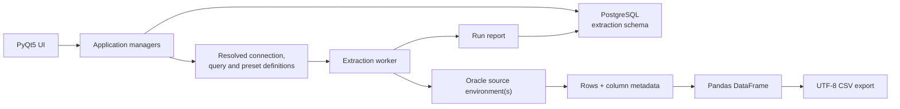

# Database Design

## 1. Overview

The application uses two database systems for different responsibilities:

| Database | Responsibility | Python integration |
|---|---|---|
| PostgreSQL | Application metadata, saved configuration, extraction request details, and run history | `psycopg2` |
| Oracle | Source data queried by extraction jobs | `python-oracledb` |

Keeping these responsibilities separate allows the application to manage extraction definitions centrally while querying data from multiple Oracle environments.

## 2. PostgreSQL: application persistence

The PostgreSQL implementation is located in `core/postgres_managers/`.

`PostgresDBManager` reads the `DATABASE_URL` environment variable and creates a `psycopg2.pool.SimpleConnectionPool` with the following configuration:

| Setting | Current value |
|---|---:|
| Minimum connections | 1 |
| Maximum connections | 5 |

The persistence managers use the `extraction` schema.

### Referenced tables and views

The current source code references the following schema objects:

| Object | Observed purpose |
|---|---|
| `extraction.connections` | Saved source connection definitions |
| `extraction.queries` | Saved SQL query definitions |
| `extraction.presets` | Preset definitions |
| `extraction.export_configs` | Export configuration definitions |
| `extraction.extraction_run` | Extraction run records |
| `extraction.extraction_run_report` | Extraction run report data |
| `extraction.v_export_config_items` | Export configuration item view |
| `extraction.v_sr_view` | Service request view |
| `extraction.v_history_view` | Extraction history view |
| `extraction.v_preset_items` | Preset item view |

These names and their usage are derived from the application code. The repository does not contain the complete DDL, constraints, indexes, or migration history. Treat the list as an inventory of referenced objects, not a complete relational schema specification.

### Persistence managers

The PostgreSQL manager package contains dedicated managers for:

- Connections
- Queries
- Presets
- Export configurations
- Exports / service requests
- Extraction history

The application-level managers in `core/managers/` coordinate with these persistence classes and are used by the UI.

## 3. Oracle: source data access

The Oracle client is implemented in `core/oracle/db_client.py`.

Each configured Oracle environment is represented by a `DBClient`. The client creates a `python-oracledb` connection pool.

| Setting | Current value |
|---|---:|
| Minimum connections | 2 |
| Maximum connections | 10 |
| Increment | 1 |
| Timeout | 60 seconds |

The client exposes methods for:

- Executing SELECT statements and returning rows with column metadata.
- Executing DML statements and returning the affected row count.
- Closing the connection pool.

For extraction, the worker obtains the relevant client, executes the configured SELECT query, and converts the returned rows into a Pandas DataFrame.

## 4. Data flow



## 5. Connection configuration

The PostgreSQL connection string is supplied through the `DATABASE_URL` environment variable.

Example placeholder:

```dotenv
DATABASE_URL=postgresql://<username>:<password>@<host>:<port>/<database>
```

Do not commit real credentials, connection strings, or production host details to source control.

Oracle connection definitions are managed by the application and persisted in PostgreSQL. The current implementation reads connection details including the user, password, and DSN from the connections data.

**Security note:** the repository code does not demonstrate application-level encryption of the stored Oracle password values. Before using this design with sensitive or production credentials, protect the database and its backups, restrict access, and consider moving secrets to a dedicated secrets manager or another approved credential store.

## 6. Provisioning requirements

The application expects the PostgreSQL `extraction` schema and referenced tables/views to exist. The repository does not currently provide a complete schema creation or migration script.

Before running the application in a new environment:

1. Provision a supported PostgreSQL database.
2. Create the `extraction` schema and all required tables and views.
3. Apply the required permissions for the application database user.
4. Configure `DATABASE_URL`.
5. Add the Oracle source connection definitions through the application or the approved provisioning process.
6. Verify connectivity to PostgreSQL and each required Oracle environment.

The exact column definitions, relationships, constraints, and indexes must be taken from the authoritative database DDL used by the deployment environment.
